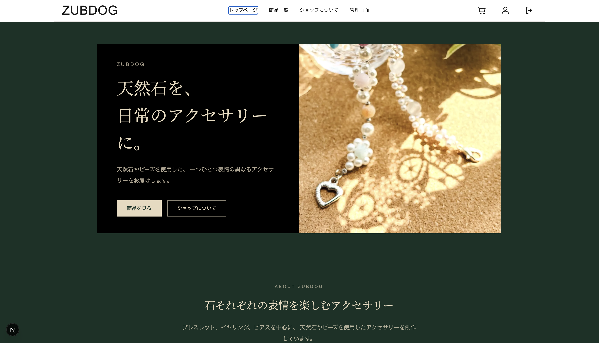
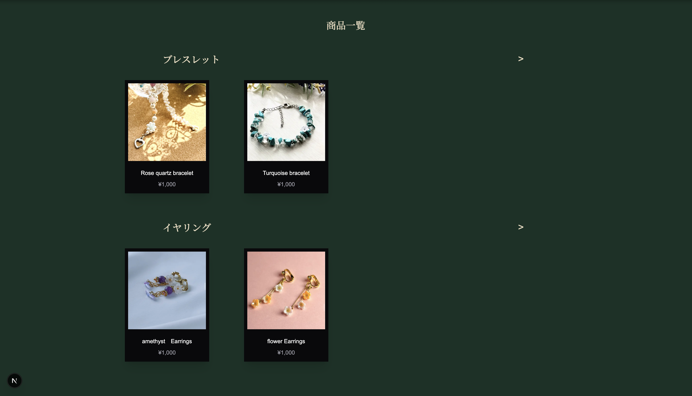
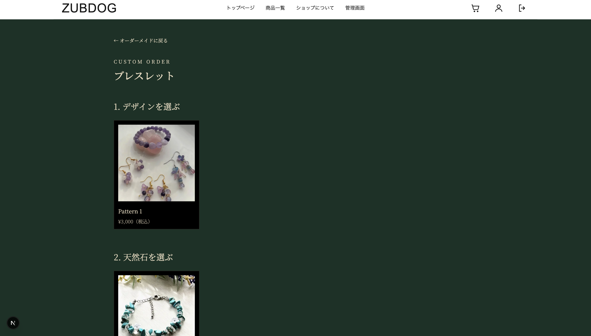
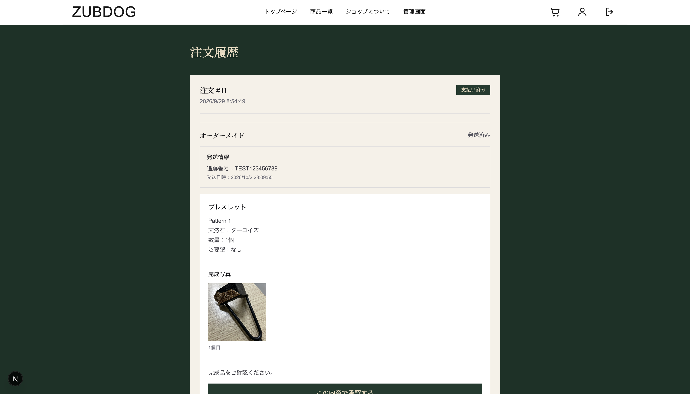
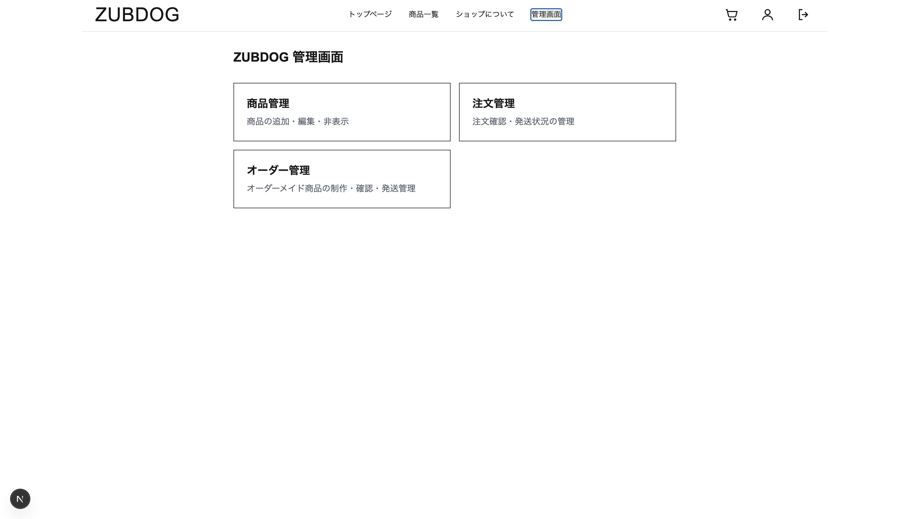

# ZUBDOG

ハンドメイドアクセサリー向けのフルスタックECサイトです。

通常商品の購入機能に加えて、デザイン・天然石・数量・要望を指定できるオーダーメイド注文システムを実装しています。

現在開発中で、2026年12月の一般公開を予定しています。

---
## Screenshots

### トップページ



### 商品一覧



### オーダーメイド注文



### 注文履歴



### 管理画面



---
## 開発目的

一般的なECサイトの機能に加えて、

「オーダーメイド商品の制作状況を、販売者と購入者の両方がWeb上で確認できる仕組み」

を作ることを目的として開発しています。

オーダーメイド商品では、

注文  
→ 制作  
→ 完成写真の確認  
→ 修正依頼  
→ 再確認  
→ 発送

という通常の商品販売とは異なる流れが必要になります。

ZUBDOGでは、この一連の流れをECサイト内で完結できるように設計しています。

---

## 主な機能

### ユーザー向け

- 商品一覧表示
- カテゴリ別商品表示
- 商品詳細ページ
- ショッピングカート
- ユーザー登録 / ログイン
- Stripeによる決済
- 注文履歴の確認
- 発送状況の確認
- 追跡番号の表示

### オーダーメイド注文

- デザイン選択
- 天然石選択
- 数量指定
- 要望入力
- 注文内容に応じた価格計算
- オーダーメイド商品の決済
- 完成写真の確認
- 完成品の承認
- 修正依頼
- 修正版の再確認
- 発送状況・追跡番号確認

### 管理者向け

- 商品登録
- 商品編集
- 注文管理
- オーダーメイド注文管理
- 制作ステータス管理
- 完成写真アップロード
- 修正依頼確認
- 修正版写真登録
- 発送処理
- 追跡番号登録
- 顧客へのメール通知

---

## 使用技術

### Frontend

- Next.js
- React
- TypeScript
- Tailwind CSS

### Backend / Database

- Supabase
  - PostgreSQL
  - Authentication
  - Storage

### Payment

- Stripe

### Email

- Resend

### Development

- Git
- GitHub
- VS Code

---
## セットアップ

### 1. リポジトリを取得

```bash
git clone https://github.com/agematsu4321-create/zubdog.git
cd zubdog
npm install
```

### 2. 環境変数を設定

`.env.example` を参考に `.env.local` を作成します。

```bash
cp .env.example .env.local
```

Supabase、Stripe、Resendの環境変数を設定してください。

実際の値はセキュリティ上GitHubには含めていません。

### 3. 開発サーバーを起動

```bash
npm run dev
```

ブラウザで以下を開きます。

```text
http://localhost:3000
```

### 4. Stripe Webhook

ローカル開発時はStripe CLIを使用します。

```bash
stripe listen --forward-to localhost:3000/api/webhook
```

取得したWebhook Signing Secretを `.env.local` の `STRIPE_WEBHOOK_SECRET` に設定します。

---

## オーダーメイド注文フロー
## 工夫した点

ZUBDOGでは、通常の商品購入だけでなく、オーダーメイド商品の注文から制作、確認、修正、発送までをWeb上で完結できるように設計しました。

特に、オーダーメイド商品では注文時点の価格や選択内容をサーバー側で保存し、決済後に内容が変わらないようにしています。

また、完成写真はPrivate Storageに保存し、購入者が注文履歴から確認できるようにしました。

Stripe Webhookについては、同じイベントが複数回送信された場合でも注文や注文商品が二重登録されないよう、UNIQUE制約とupsertを利用して冪等性を考慮しています。

---

## 技術的に難しかった点

### Stripe決済と注文データの連携

Stripe Checkoutの決済結果をWebhookで受け取り、Supabaseに注文情報を保存する処理を実装しました。

Webhookは同じイベントが再送される可能性があるため、同じ決済から注文データが重複して作成されないようにする必要がありました。

データベース側のUNIQUE制約とupsertを組み合わせ、実際に同じWebhookイベントを再送しても注文データが増えないことを確認しました。

### オーダーメイド注文フロー

通常の商品購入とは異なり、

注文
→ 制作
→ 完成写真の確認
→ 承認または修正依頼
→ 再確認
→ 発送

という複数の状態を管理する必要がありました。

そのため、注文・注文商品・完成写真・修正依頼をそれぞれ分けて管理し、注文状態によってユーザー画面と管理画面の表示や操作を切り替える構成にしました。

### セキュリティ

SupabaseのRow Level Securityを使用し、ユーザーが自分自身の注文のみ閲覧できるようにしています。

管理画面についても、未ログインユーザーや一般ユーザーがURLを直接入力してもアクセスできないことを確認しています。

完成写真のStorageはPrivate Bucketとして設定し、Signed URLを使用して表示しています。
## 今後の実装予定

現在は主要なEC機能とオーダーメイド注文フローまで実装しています。

2026年12月の一般公開に向けて、以下を進める予定です。

- 実際の商品写真・商品データへの置き換え
- スマートフォン表示の最終調整
- 本番環境へのデプロイ
- 本番用Stripe・Supabase環境の設定
- エラー処理・入力バリデーションの強化
- 購入から発送までのE2Eテスト
- テストデータの整理
- UI / UXの最終調整

また、現在は購入者の確認を待つオーダーメイド注文について、一定期間経過後の処理は管理者が手動で行う設計になっているため、今後は自動化も検討しています。
